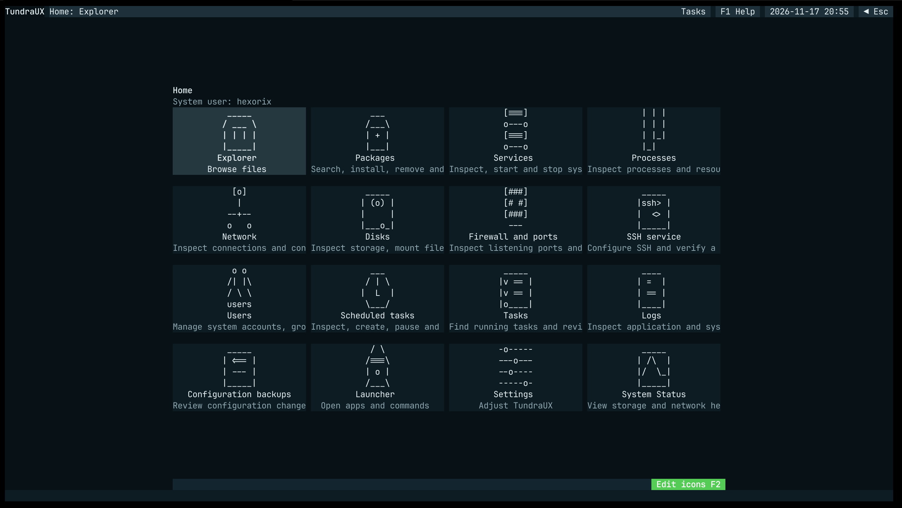
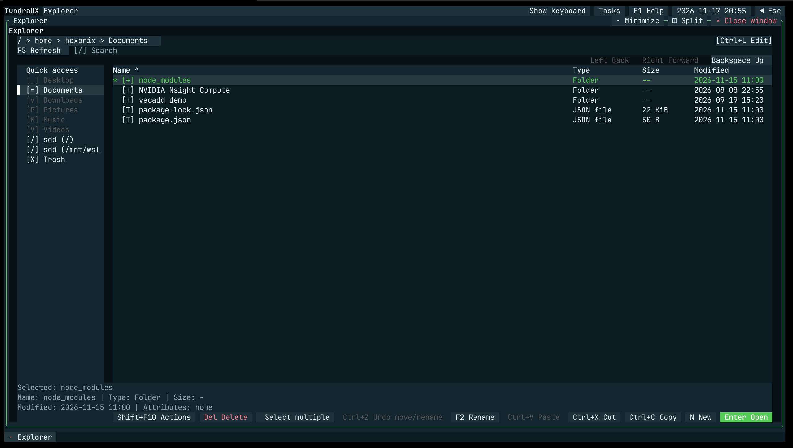
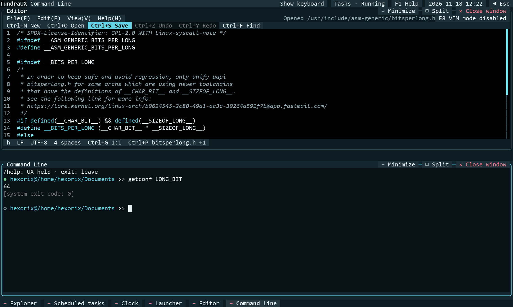
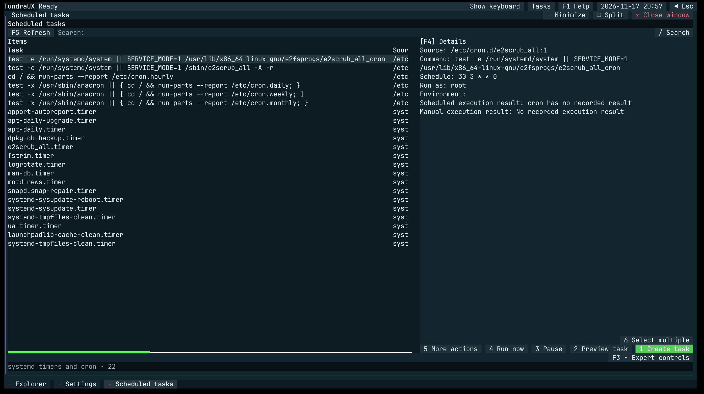
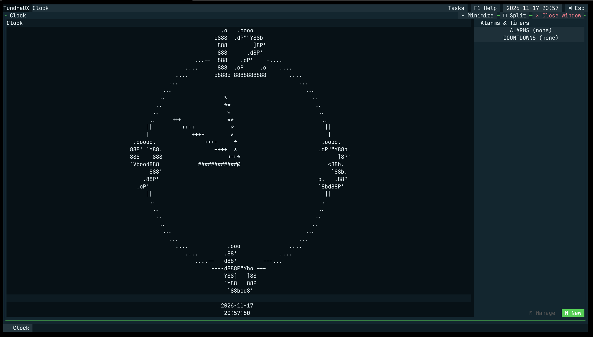

# TundraUX

**A terminal workspace for managing your device.**

English | [简体中文](docs/README.zh-CN.md)

TundraUX brings system tools, files, and everyday apps together in one terminal workspace. It is designed primarily for Linux devices, including those without a graphical desktop, and also runs on macOS and Windows. Some system management features are available only on Linux.

You can use it with a keyboard, mouse or both.
## Home

Find apps and settings, and manage software, services, networks, and more.



## File explorer

Browse, search, and organize files and folders.



## Split view

Open several apps in the same workspace and use them at the same time.



## Scheduled tasks

View and manage scheduled tasks on Linux.



## Clock

Check the time and use alarms and countdowns.



## Build from source

From the project directory:

```sh
cargo build --locked -p shell -p cli
python3 scripts/build-vim.py --output target/debug/vim
cargo run --locked -p shell --bin tundra-shell
```

On Windows, use `python` if `python3` is unavailable.

See the [build guide](docs/README-TECHNICAL.md#building-and-running) for requirements.

## Learn more

[Download TundraUX](https://github.com/peixuanthomas/TundraUX/releases) · [Documentation](docs/README.md)

## License

The project code is licensed under [GPL-3.0-only](LICENSE). Bundled third-party components retain their respective licenses.
