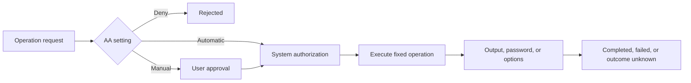

# auto-admin

AutoAdmin (AA) handles approval before built-in management operations run, passes passwords, options, and terminal input while they run, and receives the final results.

| Component | Responsibility |
| --- | --- |
| `auto-admin` | Approval state, task input, stop requests, results, and Linux authorization connections |
| Shell | Dialogs, focus, buttons, on-screen keyboard, and page navigation back |
| watchdog | Task creation, panic recording, and thread cleanup |
| platform | Fixed system operations and actual permission checks |

## Modules

| Location | Responsibility |
| --- | --- |
| [`lib.rs`](src/lib.rs) | `AutoAdminJob` owns approval, phase, display snapshot, questions, input handling, and the worker's result. It exposes prompt state to Shell without owning the dialog or focus. |
| [`tasks`](src/tasks.rs) | Starts a supervised job, waits for approval when required, hands off operation events, and finalizes the task and history. |
| [`stop`](src/stop.rs) | Tracks stop and force-stop requests and the state presented while the worker or helper exits. |
| [`linux`](src/linux.rs) | Bridges the job to Linux authorization and helper terminal I/O, including managed cleanup of the authorization process. |

## Operation lifecycle



AA policies are `manual`, `automatic`, and `deny`. Automatic approval skips only AA confirmation; system authorization and the program's own prompts still require responses. Passwords are used only for the current input and are not written to logs, arguments, or configuration.

Approval, execution, cancellation, and results are synchronized to the shared task history. Output is archived in chunks; secret input is not archived. Pages and helpers use stable IDs, and read-only queries and previews are not registered as modification tasks.

Published output, questions, results, and worker completion notify the optional platform host-loop callback after releasing shared display state.

Homebrew operations also use AA. brew runs as the current macOS user, and native installers receive system passwords for Casks through the task terminal.

## Documentation and validation

- [Approval, input, and termination workflow](docs/workflow.md)
- [Authorization connections and revocation](../platform/docs/authorization.md)
- [Task history](../platform/docs/task-history.md)

```sh
cargo test --locked -p auto-admin
```

Shell's AA tests cover dialogs, focus, password masking, and external control snapshots. Linux authorization interactions are validated in the corresponding test environment.
