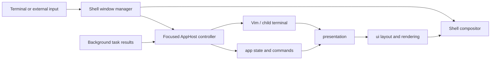

# shell

`shell` provides `tundra-shell` and coordinates the workspace. The entry process is the guardian; it supervises Shell, SessionServices, and one AppHost per managed window. The Shell worker reads the host terminal and writes the final display. AppHosts run controllers and render their own content. See the [process diagram](../../docs/README-TECHNICAL.md#process-architecture) for the connections between them.

## Module structure

| Location | Responsibility |
| --- | --- |
| [`src/main.rs`](src/main.rs) | Binary entry: arguments, Linux identity checks, interrupted update recovery, worker dispatch, restart, reset, and updater handoff |
| [`startup/`](src/startup/) | `launch_args` parses public flags; `linux_startup` checks identity and root confirmation; `terminal_size` measures the minimum. `banner`, `startup_banner`, and `first_run_banner` prepare startup visuals. |
| [`process_host/`](src/process_host/) | `guardian` creates workers and recovers the terminal; `client` connects each worker; `transport` handles managed IPC and bounded window codecs; `event_loop` wakes hosts. `delegated` registers Linux CLI children; `desktop` delegates Windows desktop opens to the guardian. |
| [`input/`](src/input/) | `terminal_events` maps Crossterm into UI events; `terminal_batch` drains and coalesces them. `input_events`, `shell_commands`, `shell_components`, and `shortcuts` define Shell routing vocabulary. |
| [`session/`](src/session/) | Interactive Shell and AppHost business loops, window and page state, controllers, and frame composition; see the breakdown below. |
| [`session_services/`](src/session_services/) | `server` and `state` own shared revisions, persist writes, and handle file-operation requests. `clock` manages shared clock state. `client`, `client_worker`, and `client_jobs` exchange requests and publish cached snapshots or completion receipts. |
| [`notification_center`](src/notification_center.rs), [`spring_style`](src/spring_style.rs) | Shell-facing notification types and shared animation style integration |
| [`previews/`](src/previews/) | Local debug programs for common controls, styles, rainbow text, AA, and the on-screen keyboard |
| [`build.rs`](build.rs) | Copies canonical resource files beside the built program. |

### Session modules

| Area | Modules under [`src/session/`](src/session/) | Responsibility |
| --- | --- | --- |
| Host loops | `runtime`, `app_host`, `construction`, `ui_state` | Drive Shell and AppHost, construct their initial state, and store host-specific UI state |
| Window management | `workspace/`, `window_state`, `window_launch` | Track live windows, split topology, focus, Ctrl+W, taskbar and chooser state, viewport generations, and managed launches |
| Pages | `navigation`, `page_state`, `page_lifecycle`, `tasks` | Keep the opening path and per-instance state, run close checks, and associate each job and reply with its owner |
| Page actions | `controller/`, `queries`, `services_client`, `clock_workspace`, `localization` | Dispatch page commands, consume background work, and bridge session snapshots, clock state, and language to a window |
| Native child hosts | `command_line_runtime`, `vim_host` (including `install`), `script_host` | Start and poll the runtime for each window; handle terminal input, editor synchronization or script results, and cleanup |
| Frame and output | `presentation/`, `compositor/`, `automation`, `redraw` | Build view models, combine app frames and global UI, capture automation state, and choose when a new frame is needed |
| Dialog and motion state | `overlays`, `overlay_focus`, `overlay_input`, `motion_effects`, `panel_motion`, `spring_progress` | Order dialogs, intercept input, restore focus, and track visual transitions |
| Special surfaces | `screen_keyboard`, `screen_saver` | Own the visible keyboard target and track idle weather and wake state |

Packages offers Add to Launcher after a successful install and for selected packages in Installed. A batch lets the user pick a package. Multiple commands open a searchable list. A single command fills the existing custom Launcher form, and an empty result leaves the command editable. The Shell saves the entry when the user confirms.

### Page controllers

| Modules under [`session/controller/`](src/session/controller/) | Responsibility |
| --- | --- |
| `input/`, `background` | Shared hit testing, focus traversal, pointer capture, Home ordering and navigation, command dispatch, and polling of accepted results |
| `editor/`, `script` | Document and settings actions, menus, find, save and recovery tasks, Vim switching, and run/pause/breakpoint controls |
| `explorer/`, `launcher/`, `command_line/` | Browser and save picker, file tasks, launch/edit/reorder actions, and embedded CLI navigation |
| `management/`, `auto_admin/`, `privilege_session` | System pages, selected targets, action forms, package and scheduled-task flows, configuration editing/backups, task output, AA prompts, and authorization lifetime |
| `account/`, `settings/`, `clock/` | First-run setup and account actions, configuration and update dialogs, and clock-item editing and synchronization |
| `logs/`, `diagnostics/`, `system_status/`, `notifications/`, `help/` | Screen-specific selection, filtering, detail or repair actions, notifications, and contextual F1 help |

Opening an archive in Explorer prompts for an extraction folder. **More → Compress to…** creates an archive from selected files and folders. The dialog handles optional passwords, retries, and destination conflicts. The Tasks view tracks progress and cancellation.

Explorer's asynchronous Rename and Undo completions merge refreshed listings into the live page, preserving search, sort, selection, and navigation changes made while the operation runs.

## Worker lifecycle and shared state

Shell attaches to the current system user, initializes assets and storage, and opens first-time setup or Home. It owns global input, pane focus, the display, and idle weather. AppHosts own their page state and child processes. Keeping idle weather in the Shell prevents an AppHost from interpreting a wake action in its active dialog.

AppHost runs recovery and task cleanup once on normal close, supervisor shutdown, or an IPC error. Explicitly discarded drafts remain discarded. The guardian can terminate an unresponsive window and clean up its children independently. If the Windows Shell stops during an inline image, the guardian releases the terminal display before restoring the original cursor. The embedded Command Line's explicit `/debug test-watchdog-panic` request reaches Shell's fullscreen panic boundary; ordinary command exit codes and AppHost failures stay within their window.

SessionServices shares configuration, profile, clock, system status, and file operation state. It checks the profile revision and saves appearance and dashboard changes before publication. A background connection owns the I/O. AppHosts initialize from one coherent snapshot and reuse an immutable cached snapshot for reads.

Interactive saves deliver completion to the original session, page, and draft. Pending saves participate in the close check. A failure cancels an ordinary close and keeps its error visible. An explicit **Stop and close** applies to the current request. Dropping a shared operation's task owner cancels and wakes the worker without blocking the UI thread; the process waits for managed work after its event loop ends.

## Redraw and background work

Background controllers report whether they consumed content, layout, notification, or task changes. The Shell and AppHost merge those results into redraw requests without cloning the whole session or comparing hit maps. Input requests an immediate frame; unchanged polls keep the existing frame and controls. Shell checks the header clock once per second while it is visible and requests a frame when the displayed date or minute changes. Visible Clock pages redraw each second. Alarms, notifications, keyboard feedback, recovery, and live queries run on their own schedule. Hidden or undersized AppHosts continue tasks and child-terminal polling but skip rendering. Active background work and native child adapters retain a 16ms fallback alongside result notifications for completion and process-state checks; idle hosts do not use that timer. System metric snapshots redraw System Status and actual alert changes; unrelated static pages retain their existing frames.

Scheduled-task preview debounce deadlines run only on the time step while no preview request is active. Returning to an earlier step keeps the draft without leaving an expired timer in the event loop.

Failed editor recovery writes retain the dirty draft and retry after ten seconds. Editing does not postpone that retry deadline; normal close can still request an immediate recovery write and require its actual result.

External input fences confirm file Copy/Cut after the shared clipboard service completes the corresponding change. Later file writes have their own receipts. Physical input feedback and other windows continue while a fence waits.

SessionServices holds one text clipboard in memory for the active login and clears it when the login changes. Editor, forms, search fields, diagnostics, the on-screen keyboard, and child terminal selection share it across AppHosts. Clipboard requests read the current value and acknowledge a write directly. Cut deletes the selected text after that acknowledgment. Terminal bracketed paste types text and leaves the clipboard untouched.

## Session flow



Opening a managed application restores a running window or creates an AppHost if needed. **New session** starts a separate AppHost. Opening a subpage within an application creates a new `PageInstanceId`. Covered pages retain their state, and task results are checked against their owner.

Shell validates the configured language and its English fallback during the startup animation. It sends the current validated resources and language choices to new AppHosts. AppHosts rebuild their translation bundles in memory and load from disk if the shared resources are unavailable or the configured language has changed. Choosing the current language again in Settings refreshes the resources for new windows.

Shell caches the exported language data for each language generation. Initialization shares this immutable data through the Shell's queues instead of copying its strings for every window. New AppHosts consume the received data and restore shared translation bundles alongside loading static assets; unavailable or mismatched language data follows the same disk recovery path as before.

Worker entry connects to the guardian before loading language bundles. AppHosts use the Shell snapshot when constructing the session; early failures retain the lazy embedded diagnostic fallback.
After an AppHost welcomes the Shell, its current viewport and initialization join the bounded background sender in the same event-loop turn, before the next terminal draw or wait.

When closing a page with running work, users can continue in the background, cancel and close, or stay on the page. watchdog handles task execution and process supervision; Shell handles the page a task belongs to, cancellation choices, and result presentation.

Click the title on any page to open the power menu, which includes Tasks. Click the status beside the title for the focused app’s full status and this session’s warnings, errors, and critical reports. Each card names its source and can be dismissed individually. Closed and hidden windows keep their history on the desktop. After an abnormal exit, the panel offers that session’s report to users with diagnostics access. **Settings → System → Top bar contents** controls status alignment and the visibility of Help, clock, and Back. First-time setup can finish with default appearance using F9.

## Windows

Every application window has **Minimize**, **Split**, and **Close** controls. Split offers **Left/right**, **Top/bottom**, and **Full screen**. A split keeps the current app on the left or top and opens a searchable app selector in the new region. Choose a minimized window or start a new session from the catalog. The mouse wheel scrolls the list while the up and down arrows move the selection. Cancel rolls back only that split. Unavailable directions remain visible and disabled.

Split the focused pane incrementally: three-window T layouts are supported, with a maximum of four panes in a 2×2 grid. Each path can split once in each direction. Full screen keeps only the chosen window, minimizes the other panes, and clears the previous split. Closing or minimizing merges the empty region; restoring a window uses its previous place when possible, otherwise it replaces the focused pane.

A new window opened from another app uses the first unfocused pane in layout order when the workspace is split. In a single pane, Shell tries left/right, then top/bottom, then temporarily replaces the current window. Closing or minimizing the new window restores the covered pane and returns focus to the app that opened it.

The Editor opens File Explorer in a separate window for Open, first save and Save As. Once you choose a file or confirm a filename, the picker closes and sends the path to the original Editor. Esc or Close cancels the picker. The draft stays with the Editor.

The background editor loader converts Word and Excel documents to Markdown. Office previews use the standard editor's read-only canvas.

PDFs open in the editor's dedicated read-only preview. The background renderer runs on open, page changes, and viewport changes. The preview offers Page Up and Page Down alongside clickable page controls.

The bottom row is dedicated to the window bar. Click a title to focus or restore that window. Click its × button to close it normally. Right-click for **Open**, **New session**, and **Move**. New embedded sessions use the current Launcher settings. Taskbar moves change the taskbar order for the current run. **Delete** is limited to user-added Launcher entries and removes the entry after its selected window closes successfully.

The screen keyboard fits inside the app content. Its bottom row, including Paste, Space, and Hide, sits above the window frame and the window bar.

| After Ctrl+W | Action |
| --- | --- |
| v / s | Split left/right / top/bottom |
| h/j/k/l or arrows | Focus a neighboring pane |
| o | Full screen: keep only the focused pane |
| b / w | Minimize / searchable window list |
| q / Shift+X | Normal close / force kill |
| Ctrl+W again | Send one literal Ctrl+W outside native editing areas |
| Esc | Cancel the prefix |

The old Ctrl+B prefix is removed. The ordinary editor canvas, native Vim, and embedded terminals retain their original Ctrl+W handling; use their window Split button. Shell-owned dialogs receive input before workspace shortcuts. Press/release and repeat handling prevent a held key from creating multiple splits.

Selection dialogs share a top search field, case-insensitive filtering, stable option identities, and an empty-result state. This includes window/app selection, all Settings pickers, dashboard component and size pickers, and form choices. Right-click and More action menus retain their compact layout.

**Settings → Applications → Command Line** selects the system command interpreter for newly opened Command Line sessions. Each session reads the choice at launch and continues to offer Tundra commands such as `/help`.

Drag over Command Line, script output, or a Launcher terminal to select text. Ctrl+C copies the selection, Ctrl+V pastes, and Ctrl+\ sends the foreground process the original Ctrl+C input. Right-click or Shift+F10 opens the same actions in a menu. Hold Shift to select text or open the menu in a child application with mouse reporting enabled. Vim retains its native shortcuts and registers.

Esc and the header Back button cancel one dialog, menu, drag or edit, then go back one step within the focused tool. With **Show Back button** on, the upper-right Esc control stays visible and dims when the focused tool has no step to go back. Vim and embedded terminals handle their own Esc. Press Esc on idle Home or click the top-left title to open the power menu.

Closing a window prompts for unsaved changes or running tasks. If cleanup still runs after two seconds, the Shell offers **Keep waiting** and **Force kill**. A force kill goes directly to the watchdog.

New windows show their frame and background for the first 100ms, then a localized starting indicator while awaiting usable content. The first frame replaces it immediately. Split, cancel, full screen, restore, and resize retain the last successfully displayed app frame until a frame matches the new layout and size. The retained frame stays aligned at the top left, clips text and images together, and fills added space with the canvas background. Its old pointer targets, automation actions, and cursor are suspended; window controls and keyboard input remain available.

The terminal minimum is 108 × 20 cells. The global title and bottom bars each occupy one row, and a window frame reserves one cell on each edge. Built-in app content can use the remaining 106 × 16 cells. Resizing temporarily hides windows that no longer fit. A minimized window stays in the bottom bar until restored. When a running app's minimum exceeds the terminal size, window controls remain available and app content is paused. Enlarge the terminal if a normal close needs to display a save or task confirmation.

With the default minimum, left/right needs 217×20, top/bottom 108×39, and a full 2×2 grid 217×39 terminal cells.

Embedded terminals can raise their window minimum while running. The workspace uses the largest reported dimensions across all live windows, including the background. A window leaves this calculation when the watchdog confirms it has exited.

When Shell stops responding to progress probes, the guardian ends the run and restores the terminal. AppHost failures leave other windows usable. The guardian can list or stop a session even when external UI control is disabled. See [health checks](../watchdog/README.md#workspace-guardian) and [watchdog commands](../cli/docs/commands.md#watchdog).

The compositor dims the covered interface beneath modal layers. Dialogs share the OpenCode-inspired header, body, close control, and action-band layout from `ui`. Existing notification cancel actions keep their original IDs and routing. The default surfaces use the Glacier Night blue palette.

Floating toasts preserve keyboard focus and block pointer input in the area they cover until they disappear. External control reports targets with covered click points as unavailable during that time.

## Interface hosting

- **Home:** The minimum terminal size is 108×20, shared by startup, runtime resizing and Command Line. Supported Home entries fit on one page, using name-only tiles when icons would force scrolling; smaller terminals show an error. Larger windows center the title, account, and grid while keeping the action footer at the bottom. F2 or the Edit icons button enters edit mode. Pointer drops and Shift+Left/Right save icon order in each user’s `home.order.<username>` state entry. Esc cancels a drag first, then finishes editing; focus loss, resizing, overlays, and navigation cancel pending drops.
- **Home and Launcher:** Home shortcuts and Launcher use the same app catalog and opening actions. Removing a shortcut from Home leaves the app in Launcher. Launcher opens with search focused and matches names and descriptions from the active language pack alongside paths, commands, and types. An exact app name is selected first. Enter launches it and Down focuses the results. Esc clears a query, then returns to the opener. Work already running continues in the session. In organize mode both grids put a `#` beside each draggable name and mark the drop position with a vertical line.
- **Files:** The path row has Back, Parent, and Forward. Esc follows visit history. Tab and Shift+Tab move between enabled controls while keeping the directory and selected files. The sidebar and file list each take one stop. Save As adds filename, Save, and Cancel. At 108×20 the ten common actions fit on one row. More holds sorting, properties, and advanced options. F1 lists shortcuts. Explorer windows share copied and cut files and undo history. Each window can enable Include subfolders beside Search. Changing the query or directory supersedes the background scan. Selecting a nested Save As result moves the picker to its actual parent.
- **Editor and scripts:** keep common editing tools visible, preserve the text selection when opening the standard editor's context menu, manage multi-document pages and Vim, and host script execution and debugging. F8 switches Vim mode for the current editor window. New editor windows start with the configured default. macOS text editing follows Command and Option conventions.
- **System management and logs:** present platform operations with AA authorization, shared focus and selection controls, and persistent expert areas opened with F3. UX logs keep expert filters and related actions visible while changing rows or filters; F10 still opens the menu.
- **Settings and status:** use Tab to move between regions and controls and arrows within the focused region. Advanced animation timings use one three-column form with a draft and a single save/cancel operation. New Linux profiles use ASCII icons. On a terminal with image support, users can switch to image icons in Settings → Appearance → Theme.
- **Updates:** Linux defaults to Release and shows the target build, update notes, and download progress when an update is available. On Beta and Windows, select a commit in the Git tree and confirm to download and build it. The page shows live compilation output. F5 checks again.
- **Child terminals:** each page has an independent PTY, continues reading output while covered, and cleans up its process tree when closed. Shell renders Kitty, Sixel, and iTerm2 placements from app hosts and retires image resources as panes move or become covered.
- **Clock:** clock windows share the signed-in user's alarms and countdowns and use the same synchronized time as the status bar. Shell advances reminders and presents each one. Concurrent edits check the persisted revision before saving so a stale window cannot replace newer entries. Entry layout measures action labels with the session language, including during initial shared-service synchronization.

Keyboard, mouse, and touch use the same interruptible transitions. Page, dialog, and menu bodies remain readable at fixed final coordinates from the first frame; details and the keyboard use clipped expansion. The event loop prioritizes immediate input, schedules active UI motion at 60 FPS, retains the separate 30 FPS weather/rainbow policy and 80ms busy cadence, and stops animation deadlines at rest. Slow terminal writes advance from elapsed time without replaying missed frames. Reduced motion renders the final state directly.

Terminal, Vim, and script adapters report changes from output, process errors, saves, document closure, and deferred script launches explicitly, so these events redraw even when their terminal pixels stay the same. Unchanged adapters keep their shared snapshots and request no redraw.

Shell and AppHost install the shared platform event notifier. Background task results, progress, and PTY output wake their event loops after publication; the notifier does not advance watchdog business progress.

Launcher confirmations use the current shared layout to capture button presses and releases before a redraw. Their search field and list remain covered. Explorer popup wheels move the popup selection, and right clicks retain the active popup without changing the covered file list.

See [UI requirements](../../docs/UI-requirements.md) for shared buttons, forms, animations, and layouts. See [Editor and script workspace](../../docs/source-editor.md) for editor operations and [List selection](../../docs/list-selection.md) for page multi-selection.

## External CLI control

After external CLI control is enabled in Settings → System, the same operating-system user can use `tundra-cli ui` to read controls and screen content, or send clicks, drags, scrolling, keys, and text.

`session/automation.rs` sends requests through the normal input flow, and the compositor captures snapshots from actual rendered frames. The focused window retains its `page/` control IDs. Other visible windows use `session/<id>/` prefixes. Real user actions invalidate old snapshots, requiring another `snapshot` or `wait`. Passwords remain masked in exported content. See [CLI control](../cli/docs/ui-control.md) for the protocol and examples.

Disabling external control waits for the setting's persistence receipt before completing the initiating request with `closed`. The receipt survives its Settings page closing, remains scoped to the Shell session and authorization revision, and prevents an older configuration cache from reopening control. A failed save leaves control available and exposes its error; unrelated background saves do not delay input confirmation.

Already-due wheel steps from one external scroll request share a frame without dropping steps or advancing future events. Clicks and drags retain separate press and release frames.

## App startup timings

Managed IPC shares an event wake with the UI loop. A small Tokio I/O runtime receives local-socket readiness, and a process-wide bounded worker pool handles frame encoding and decoding outside Ratatui's main thread.

Guardian listeners and connection readers and writers retain watchdog-owned cancellation handles, including on early startup errors. The shared service listener owns its peer task set; closing it cancels every accepted peer without joining on a UI thread.

Shell moves queued messages into background writers without cloning their payloads; rejected enqueue attempts return the original message for an ordered retry.

Per-window input queues stop admitting new application input when their bounded capacity is full. Shell reports that condition while keeping window management and other windows available; external CLI input receives a retryable `busy` response. Pointer cancellation, input fences, and close messages retain reserved queue capacity.

`tundra-cli logs query --module ux.workspace --format jsonl` shows one `app-startup` event per new AppHost whose first usable frame the Shell accepts. The application ID, workspace run ID, and window session ID identify the sample. Durations in `message_args` are monotonic microseconds.

| Field | Measurement |
| --- | --- |
| `total_us` | From sending `SpawnApp` to accepting the first frame for the current viewport |
| `spawn_app_us` | From sending `SpawnApp` to receiving `AppStarted`. Includes the OS process launch (`process_spawn_us`) and the guardian's subsequent wait for worker readiness and shared-service registration (`guardian_ready_wait_us`) |
| `handshake_us` | From receiving `AppStarted` through connecting to AppHost, exchanging Hello/Welcome, and queuing Init |
| `services_setup_us` | From AppHost receiving Init through connecting to SessionServices, reading configuration, and registering its local watchdog |
| `resources_us` | Loading the default ASCII artwork, icon catalogs, and clock font |
| `session_init_us` | Building and activating the AppHost session, excluding `resources_us`. Includes session construction (`session_build_us`), initial profile/config synchronization (`session_sync_us`), and opening the requested page (`launch_activate_us`). `language_load_us` measures rebuilding shared translation bundles or the disk fallback; shared restoration can overlap static asset loading. |
| `first_frame_ready_us` | From session initialization to preparation of AppHost's first frame. Includes its first event-loop poll (`first_poll_us`), any wait to render, and the actual draw and capture (`first_draw_us`) |
| `window_ipc_us` | Remaining time after the Init enqueue. Includes Init delivery, frame serialization and delivery, Shell polling and validation, and any wait for a subsequent frame if the first viewport is stale |

Restoring an existing window creates no startup sample. Page-specific background work can continue after the first frame.

AppHosts without terminal image support skip PNG file reads while loading all catalogs, clock glyphs, and text artwork before their first frame. Hosts with image support keep all image bytes available for appearance changes.

Shell sends the detected color mode to each AppHost so controls use the terminal's ANSI or truecolor styles.

`app-startup-presented` is a separate event recorded after successful terminal output. Its `total_us` runs from sending `SpawnApp` through that output; `accepted_us` retains the earlier acceptance measurement, `accepted_to_present_us` measures the remaining Shell wait, and `terminal_output_us` includes composition, terminal diffing, image retirement, cursor updates, and output for that draw. `starting_shown` records whether a Starting placeholder was actually output before the first application frame. These fields measure output completion, not a terminal emulator's pixel presentation.

Set `TUNDRA_PERF_TRACE=/absolute/path/trace.jsonl` for optional per-frame and per-input diagnostics. `input-presented` records Shell input enqueue to successful output using only the Shell's monotonic clock. Frame sequence and processed input serial identify the correspondence; `input_to_accepted_us` and `accepted_to_present_us` split that duration when the accepted frame is still available. The trace excludes input contents and is disabled by default.

## Build and validation

Session workflow tests are grouped by feature under [`tests/unit/session/workflows/`](tests/unit/session/workflows/). To run only the clock workflows, use `cargo test --locked -p shell --lib session::tests::clock::`.

The Launcher cache test checks text and PNG icons with the theme directory unavailable, then verifies that a disk edit takes effect after an explicit refresh. Package keyboard tests check the focus order for the available actions on each platform.

```sh
cargo build --locked -p shell -p cli
cargo test --locked -p shell
cargo test --locked -p shell --features native-tests
```

Enable `native-tests` on a host that permits real PTYs or ConPTYs and local sockets. This includes managed-service IPC, external UI control, and embedded terminal checks.

Shell's built-in command line uses `tundra-cli` from the same directory, so build both packages after updates. The Linux real-terminal checks use both binaries.

```sh
python3 scripts/tests/shell-control.py target/debug/tundra-shell
python3 scripts/tests/workspace-clipboard.py target/debug/tundra-shell --output /tmp/tundra-clipboard
python3 scripts/linux-shell-smoke.py target/debug/tundra-shell
```

The guardian smoke test uses a temporary home and runtime directory on Unix.

```sh
python3 scripts/tests/shell-watchdog.py target/debug/tundra-shell
```

Automation tests use short Unix socket paths. File-operation fixtures resolve the system temporary directory before exercising save, undo, and recovery.
Editor and Explorer tests seed temporary user profiles and exercise their workflows through `ShellSession`. First-run setup is covered by the account workflow tests.

## Related documentation

- [Sessions, navigation, and rendering](docs/session.md)
- [Debug interface previews](docs/previews.md)
- [UI requirements](../../docs/UI-requirements.md)
- [Built-in applications](../app/docs/applications.md)
- [CLI and Command Line](../cli/docs/commands.md)
- [terminal-runtime](../terminal-runtime/README.md) · [vim-runtime](../vim-runtime/README.md)
