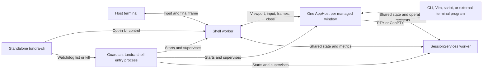

# TundraUX technical documentation

TundraUX is a Rust terminal workspace. The Shell manages windows and owns the display; each managed application runs in its own process. Application logic, UI rendering, and operating-system access have separate crate boundaries. For installation and day-to-day use, start at the [documentation index](README.md).

- [Building and running](#building-and-running)
- [Process architecture](#process-architecture)
- [Crate responsibilities](#crate-responsibilities)
- [How operations flow through the workspace](#how-operations-flow-through-the-workspace)
- [Where to make changes](#where-to-make-changes)
- [Validation](#validation) · [Linux packaging](#linux-packaging) · [Troubleshooting](#troubleshooting)

## Building and running

The [workspace manifest](../Cargo.toml) uses Rust edition 2024 and requires **Rust 1.95** or newer. From the repository root:

```sh
cargo build --locked -p shell -p cli
python3 scripts/build-vim.py --output target/debug/vim
cargo run --locked -p shell --bin tundra-shell
cargo run --locked -p cli --bin tundra-cli -- doctor
```

Build both executables together. Shell looks for its companion `tundra-cli` beside itself when it opens Command Line. For a release build, add `--release` to the Cargo commands and use `target/release/vim` for the Vim output. Windows can use `python` in place of `python3` and uses the MSVC toolchain.

Vim is an optional runtime for editor mode. Cargo does not download or build it. The [Vim build guide](packaging/vim.md) lists Python and native build dependencies, offline inputs, and how to verify the bundle. The Linux archive's [runtime guide](packaging/linux/README-LINUX.txt) lists dependencies for desktop and account integration.

Use an interactive terminal with at least **108 × 20 cells** for the default one-window layout. The app content starts at **106 × 16 cells** after the global bars and window frame. A live child terminal or custom resources can raise the required size. Mouse and touch support depend on input forwarded by the host terminal.

## Process architecture



| Process | Owns | Source entry |
| --- | --- | --- |
| Guardian | Worker identities, liveness checks, process-tree cleanup, and terminal recovery if Shell exits unexpectedly | [shell main](../crates/shell/src/main.rs), [process host](../crates/shell/src/process_host/) and [watchdog supervisor](../crates/watchdog/src/supervisor.rs) |
| Shell worker | Host input and terminal modes, Home, pane layout, global overlays, output, and system snapshot collection | [Shell runtime](../crates/shell/src/session/runtime.rs) and [workspace](../crates/shell/src/session/workspace/) |
| AppHost worker | Page instances, domain state, task ownership, child terminals, and rendering in pane-local coordinates | [AppHost](../crates/shell/src/session/app_host.rs) and [controllers](../crates/shell/src/session/controller/) |
| SessionServices worker | Session-wide configuration, profile, clock, file-operation state, and distribution of system snapshots | [session services](../crates/shell/src/session_services/) |
| CLI | Standalone commands, the embedded REPL, and internal helper entry points dispatched to the owning crates | [CLI main](../crates/cli/src/main.rs) and [runner](../crates/cli/src/runner.rs) |

The launching OS account owns the run. Startup resolves its identity, checks for interrupted updates, starts the workers, and loads assets and saved preferences. A user without completed setup sees the appearance setup before Home. Closing an app normally runs its save and task checks; the guardian can stop an unresponsive worker independently. See [Shell session lifecycle](../crates/shell/docs/session.md) and [watchdog runtime](../crates/watchdog/docs/runtime.md).

`RunId` identifies the guardian run, `SessionId` identifies one window opening within it, and `PageInstanceId` identifies a screen instance within the app. `WorkerId` includes a process generation and `LayoutGeneration` identifies the viewport. These identities let the host discard stale work after a page closes, a process exits, or the pane changes size.

## Crate responsibilities

All 20 members below are defined in [Cargo.toml](../Cargo.toml). Each README maps its source modules, entry points, and targeted checks.

| Area | Crate | Responsibility |
| --- | --- | --- |
| Workspace | [shell](../crates/shell/README.md) | Binary entry, guardian integration, worker event loops, pages, input routing, and final terminal composition |
| Workspace | [app](../crates/app/README.md) | Domain commands and state for the editor, Explorer, Launcher, clock, diagnostics, and updates |
| Workspace | [ui](../crates/ui/README.md) | View models, components, layout, hit geometry, rendering, and frame capture |
| Workspace | [cli](../crates/cli/README.md) | `tundra-cli` commands, REPL, previews, diagnostics, and helper dispatch |
| OS and data | [platform](../crates/platform/README.md) | Native paths, files, processes, terminals, system capabilities, and typed management backends |
| OS and data | [storage](../crates/storage/README.md) | Versioned application documents, atomic writes, normalization, recovery, and session configuration adapter |
| OS and data | [identity](../crates/identity/README.md) | Current OS user, session identity, and workspace permission decisions |
| OS and data | [auto-admin](../crates/auto-admin/README.md) | Approval state, interactive task input, authorization handoff, cancellation, and results |
| Native runtimes | [terminal-runtime](../crates/terminal-runtime/README.md) | Host terminal guards, child PTY/ConPTY, input encoding, emulation, and snapshots |
| Native runtimes | [vim-runtime](../crates/vim-runtime/README.md) | Real Vim process, buffer bridge, and requests for application-managed saves |
| Native runtimes | [script-runtime](../crates/script-runtime/README.md) | Linux interpreter execution and bashdb integration, with debugger events and separate terminal I/O |
| Services and resources | [system-services](../crates/system-services/README.md) | Shared system, time, and weather models; optional collection, polling, and caching runtime |
| Services and resources | [time](../crates/time/README.md) | System or HTTP-derived time, monotonic advancement, and timezone conversion |
| Services and resources | [weathr](../crates/weathr/README.md) | Weather scenes, embedded idle display, and a standalone display API |
| Services and resources | [ascii-assets](../crates/ascii-assets/README.md) | Asset discovery, distribution, validation, and repair for themes, artwork, icons, and fonts |
| Services and resources | [i18n](../crates/i18n/README.md) | Fluent catalogs, message contracts, language snapshots, fallback, and resource repair |
| Supervision and IPC | [watchdog](../crates/watchdog/README.md) | Worker supervision, owned tasks, panic boundaries, resource cleanup, and operation recovery |
| Supervision and IPC | [runtime-log](../crates/runtime-log/README.md) | Shared runtime events, redaction, retention, queries, and export |
| Supervision and IPC | [workspace-protocol](../crates/workspace-protocol/README.md) | Private worker IPC, bounded framing, and the separately versioned watchdog CLI messages |
| Supervision and IPC | [shell-control](../crates/shell-control/README.md) | Public local UI-control request, response, and snapshot types |

The process diagram shows message flow. Cargo dependencies follow a different direction: `cli` uses `shell` for shared entry points and previews; `shell` coordinates `app` and `ui`; `ui` uses app types; `app` remains independent of Ratatui, Crossterm, and `ui`. The workspace `time` crate is distinct from the external package with the same name. See each crate's manifest for the full dependency list.

Shell enables the `system-services/runtime` feature to collect and distribute system and weather data. App and Weathr use the model-only interface. `workspace-protocol` and `shell-control` define wire types; `platform` owns the local transport and peer checks. `watchdog` has no dependency on `platform`.

## How operations flow through the workspace

### Input and rendering

Shell converts host events into routed input. Global window controls and active dialogs get first refusal; page input goes to the selected AppHost. A controller turns page actions into domain commands, such as `AppCommand`, or sends native keys to the PTY. Presentation reads an `AppSnapshot` and page state to assemble view models. UI computes rectangles, draws cells, and captures controls from the same geometry. Shell composes accepted app frames with the header, window bar, and overlays. See [input routing and composition](../crates/shell/docs/session.md#input-and-event-loop).

Opt-in `tundra-cli ui` uses this same input path. It reads snapshots of actual frames and does not call page operations directly. The guardian endpoint used by `tundra-cli watchdog` is separate and remains available when Shell is unresponsive. See [UI control](../crates/cli/docs/ui-control.md) and [watchdog commands](../crates/cli/docs/commands.md#watchdog).

### Persistent and shared state

Application documents are versioned by `storage`; `platform` provides native paths and file primitives. Managed windows obtain configuration and profile data through SessionServices, which checks revisions before committing writes and publishes the persisted result. Other processes can use local storage. Window-local state such as search text, a cursor, or an unsaved editor draft belongs to its page; the file clipboard and safe move/rename history are scoped to the run and shared by Explorer windows. See [storage](../crates/storage/README.md) and [Explorer's shared operations](../crates/app/README.md).

Editor saves use a snapshot of one revision. Both the standard editor and Vim use the application save path, so a successful older save cannot clear newer edits. Recovery drafts are separate from saved files. Protected OS configuration follows its own validation, authorization, backup, and recovery path. See [editor internals](editor-scalability.md), [Vim runtime](../crates/vim-runtime/README.md), and [system configuration](../crates/platform/docs/system-config.md).

### System operations and failures

A management backend describes available queries, actions, and target identities. UI or CLI selects a typed operation. When needed, AutoAdmin manages approval and task interaction, while the platform backend enforces OS permissions and runs the fixed action. Long work runs under watchdog ownership. The host accepts the result only for the original request and owner, then refreshes the displayed state. See [Linux management](../crates/platform/docs/linux-management.md) and [AutoAdmin workflow](../crates/auto-admin/docs/workflow.md).

Task history, runtime logs, and incidents serve different needs. Task history stores operation summaries and captured output; runtime logs record structured application events; watchdog records incidents and operation checkpoints. A process failure does not imply a write was rolled back. Inspect actual state or the operation journal before retrying a write. See [task history](../crates/platform/docs/task-history.md), [logs](../crates/runtime-log/docs/logs.md), and [recovery](../crates/watchdog/docs/runtime.md).

## Where to make changes

| Change | Start here | Verify |
| --- | --- | --- |
| New key binding, page transition, or dialog action | Shell's input/router and page controller; shared components in `ui` | Focus, modal priority, key and pointer paths, and ownership of late results |
| Domain behavior such as an edit, alarm, or file workflow | `app` state and command; filesystem work in `platform` | Domain tests for the command and an app-host test for the user flow |
| Layout, view model, or new visible text | `ui`, Shell presentation, and paired Fluent resources under `ascii-assets/assets/locales/` | [UI requirements](UI-requirements.md), action geometry, narrow/wide characters, and [localization checks](../crates/i18n/docs/localization.md#validation) |
| OS query, write, or privileged command | Native `platform` backend and `management` types; use AutoAdmin for task interaction | Target platform tests and isolated acceptance checks for system writes |
| Configuration or shared-state field | `storage` document; SessionServices and protocol when the field crosses workers | Existing and invalid documents, stale revision handling, and persistence before publication |
| Child-terminal or worker protocol | Owning runtime, `workspace-protocol` for managed IPC, `shell-control` for public UI control | Bounds, lifecycle and cleanup, stale generations, and the relevant real-terminal tests |

UI renders user-visible text through i18n; preserve literal command syntax, file paths, and protocol values across languages. Underlying text is kept as Unicode, with grapheme movement in the editor and terminal-cell widths for layout. Images need a text fallback. Background tasks should declare their replay safety and publish a result before waking the UI.

## Validation

Use the [testing guide](testing.md) to choose checks for the affected crates or workflows. For workspace code changes, the baseline is:

```sh
cargo fmt --check
cargo check --workspace --locked
cargo test --workspace --locked
cargo build --locked -p shell -p cli
python3 scripts/check-localization.py
bash scripts/check-weathr-dependency-boundary.sh
```

Run platform-specific checks in the corresponding environment. A Linux PTY test exercises terminal I/O, not physical terminal graphics, Windows ConPTY, or authorization on a different platform. Use `--offline` for Cargo when dependencies are already cached.

## Linux packaging

On Linux x86_64, build Vim and create the portable archive:

```sh
python3 scripts/build-vim.py --output target/release/vim
bash scripts/package-linux.sh
```

The [packaging script](../scripts/package-linux.sh) builds locked release executables and writes the tarball and separate `SHA256SUMS` file to `dist/` by default. Set `TUNDRAUX_DIST_DIR` to override the output directory or `TUNDRAUX_VERSION` to override the workspace version in the archive name.

The archive contains the binaries, `assets/`, `vim/`, installation marker, `install-tux.sh`, licenses, and runtime guide. Keep that layout intact for portable updates. See [application self-updates](../crates/app/docs/update.md) for the replacement and rollback contract.

## Third-party components

| Component | Integration |
| --- | --- |
| [Crossterm](../third_party/crossterm/TUNDRA_PATCH.md) | Host input message boundaries, timeouts, limits, and diagnostics |
| [interprocess](../third_party/interprocess/TUNDRA-PATCHES.md) | Local IPC dependency for platform transport and cleanup |
| [vt100](../third_party/vt100/TUNDRA_PATCH.md) | Terminal parser with local scrollback fixes, used by AutoAdmin |
| [WezTerm terminal core](../third_party/wezterm-term/TUNDRA_PATCH.md) | In-memory child-terminal emulation and embedded I/O changes |
| [LSH](../third_party/lsh/TUNDRA-NOTICE.md) | Syntax highlighting for source files |
| [bashdb](../third_party/bashdb/TUNDRA-PATCHES.md) | Bundled Linux Bash debugger and local bridge fixes |
| [OpenCode reference](../third_party/opencode/README.md) | Loading animation curves adapted under MIT |
| [Bundled Vim](packaging/vim.md) | Pinned upstream engine built outside Cargo and shipped with its runtime and license |

The workspace's `[patch.crates-io]` entries identify patched Cargo dependencies. Project code uses [GPL-3.0-only](../LICENSE); Weathr uses [GPL-3.0-or-later](../crates/weathr/LICENSE.weathr). Check the component notices and licenses when changing bundled code or assets.

## Troubleshooting

| Symptom | Check |
| --- | --- |
| Terminal reports insufficient size | Enlarge it or minimize extra panes. Check window minimums and child applications if it already exceeds 108 × 20. |
| Command Line uses a different build | Rebuild both binaries and check that Shell is running beside the expected CLI. |
| Paths, permissions, or capabilities differ from expectations | Run `tundra-cli doctor` and `tundra-cli debug paths`. See [platform integration](../crates/platform/docs/integration.md). |
| Shell or an app stops responding | Use [watchdog commands](../crates/cli/docs/commands.md#watchdog) from a second terminal under the same account. If terminal modes are left incorrect, reset the terminal and inspect the incident report. |
| Configuration or state is damaged | Review the reported paths and backups. Use [storage recovery](../crates/storage/README.md#safe-saving-and-recovery) before considering [resetting all application data](../crates/cli/docs/commands.md#data-reset). |
| Graphical opening or clipboard fails on Linux | Check the terminal session and desktop helpers in the [Linux runtime guide](packaging/linux/README-LINUX.txt). |
