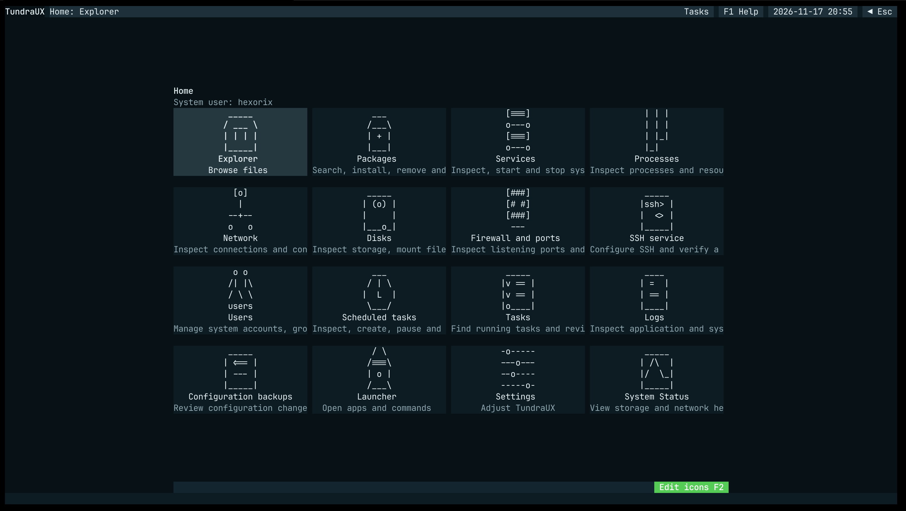
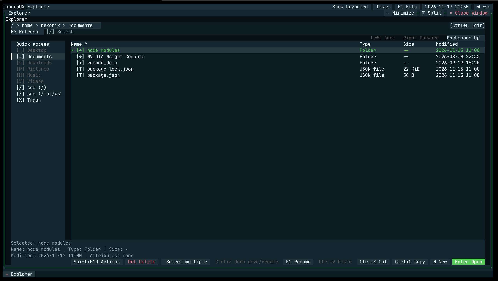
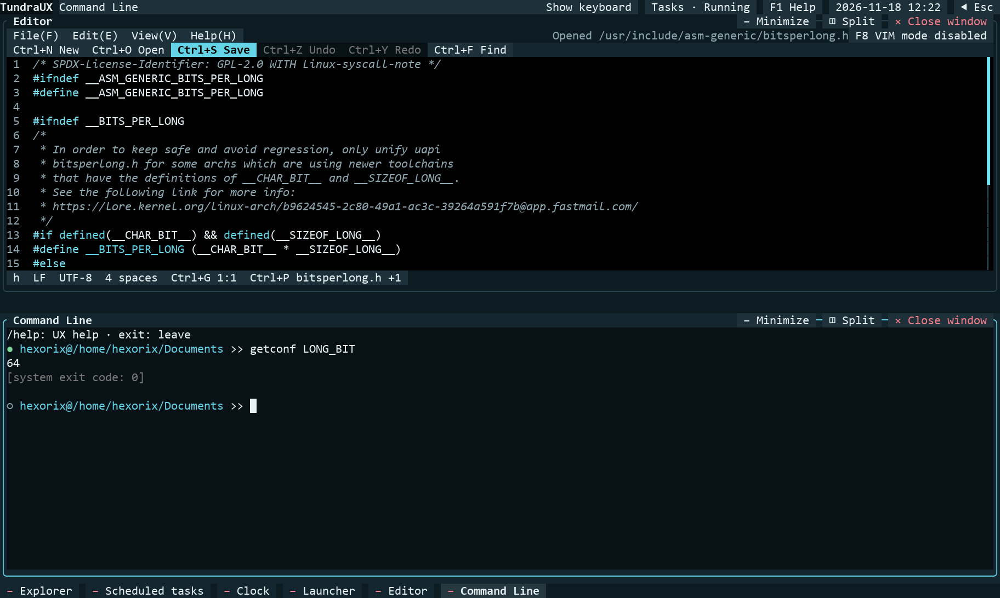
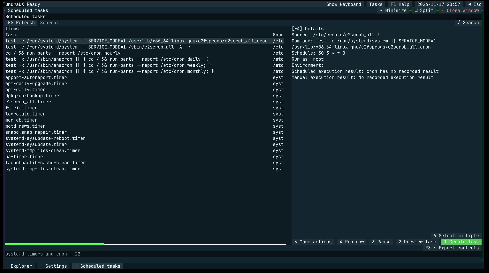
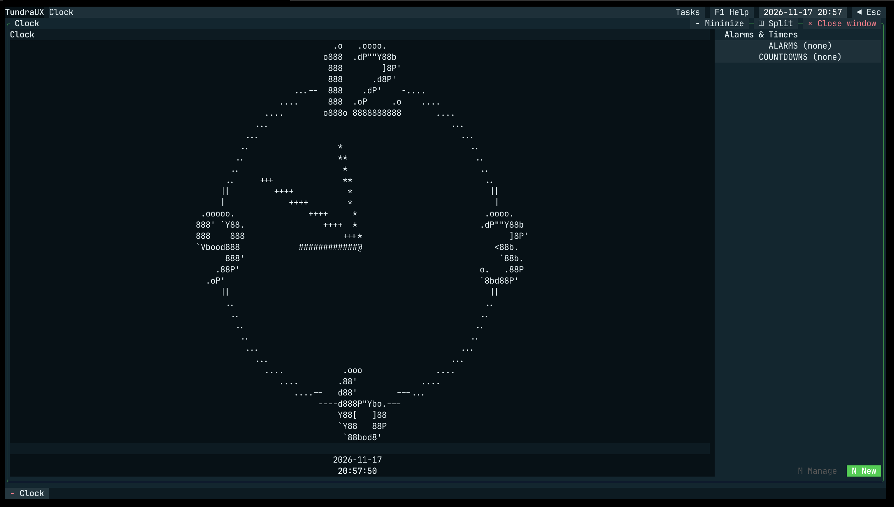

# TundraUX

**在终端里管理设备的集成工作区。**

[English](../README.md) | 简体中文

TundraUX 把系统工具、文件和日常应用放在同一个终端工作区中。它主要面向 Linux 设备，包括没有图形桌面的设备，也可以在 macOS 和 Windows 上运行。部分系统管理功能仅在 Linux 上提供。

你可以使用键盘、鼠标或触摸屏操作。

## 首页

选择快捷入口打开应用。启动器里可以浏览可用应用、添加自定义应用，并选择哪些应用显示在主页。



## 文件管理

浏览、搜索和整理文件与文件夹。

内置编辑器可以将 Word（`.docx`）和 Excel（`.xlsx`）文件渲染成只读 Markdown 预览。



## 分屏

在一个工作区里同时打开和使用多个应用。从一个应用打开文件时，关闭文件窗口就能回到原应用。



## 计划任务

在 Linux 上查看和管理计划任务。



## 时钟

查看时间，使用闹钟和倒计时。



## 从源码构建

在项目目录中运行：

```sh
cargo build --locked -p shell -p cli
python3 scripts/build-vim.py --output target/debug/vim
cargo run --locked -p shell --bin tundra-shell
```

Windows 没有 `python3` 命令时可使用 `python`。

所需环境见[构建指南](README-TECHNICAL.md#building-and-running)。

## 了解更多

[下载 TundraUX](https://github.com/peixuanthomas/TundraUX/releases) · [文档](README.md)

## 许可证

项目代码采用 [GPL-3.0-only](../LICENSE)。随包第三方组件保留各自的许可证。
